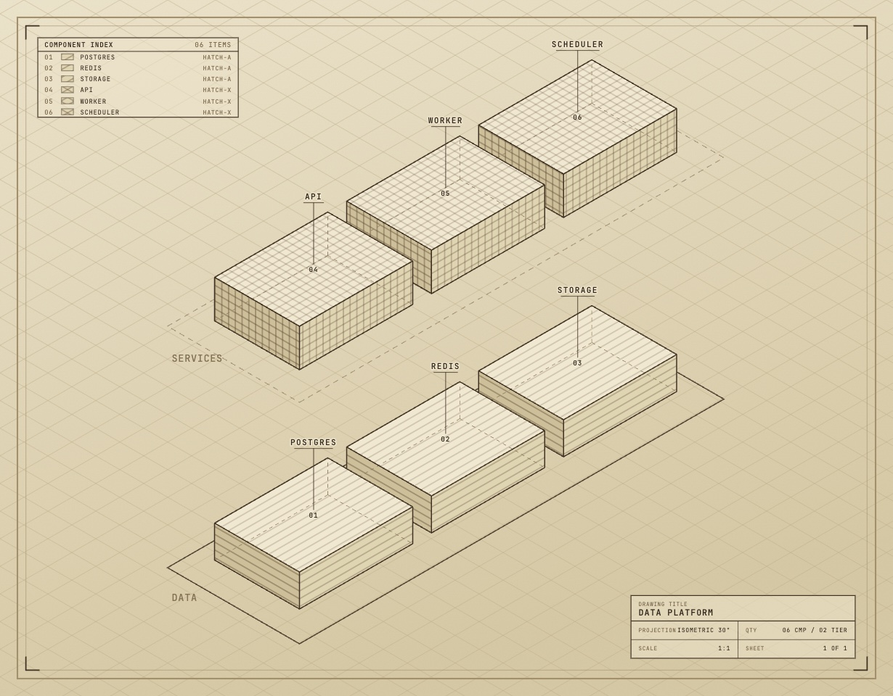

# @hudsonkit/arc-iso

Isometric architecture diagrams as code. Describe the system as stacked tiers
of blocks in YAML or a typed object, then render it with a React component or
as a plain SVG string.



## Install

```bash
npm install @hudsonkit/arc-iso react react-dom
```

Install `react` and `react-dom` even if you only use the vanilla renderer.
Every entry point imports React when it loads.

## Write a diagram in YAML

The image above is this file, drawn by `ArcDiagram` with `style: 'blueprint'`:

```yaml
title: Data platform
theme: light
canvas: 820x640
floor: 450x140
origin: { x: 275, y: 590 }

colors:
  db: blue
  svc: violet

tiers:
  - Data @ 0
  - Services @ 220

nodes:
  0:
    - Postgres  db   25,25    120x90x34
    - Redis     db   165,25   120x90x34
    - Storage   db   305,25   120x90x34
  1:
    - API       svc  25,25    120x90x40
    - Worker    svc  165,25   120x90x40
    - Scheduler svc  305,25   120x90x40
```

- `canvas` and `floor` are `WIDTHxHEIGHT`. The floor's second number is its depth.
- `origin` is where the floor's front corner sits on the canvas. It defaults
  to the horizontal center, 80px above the bottom edge.
- Each tier is `Name @ elevation`.
- Each node line is `Label color x,y widthxdepthxheight`. The label is one
  word; use the object form below for longer labels.
- A color is a palette name (`blue`, `violet`, `cyan`, `emerald`, `amber`,
  `rose`, `slate`) or a key from `colors`. Write the key without `*`.
- End a node line with `{ key=value ... }` to set extra fields, for example
  `{ opacity=0.8 }`.
- A node can also be an object: `{ label: Event bus, color: amber, x: 25, y: 25, width: 120, depth: 90, height: 34 }`.
- `pillars` connect tiers: `- 85,70 0->1` draws a pillar at 85,70 from tier
  0 to tier 1.

`parseYamlConfig(yaml)` turns this into a `DiagramConfig`. `configToYaml(config)`
writes one back out.

## Render with React

```tsx
import { ArcDiagram, parseYamlConfig } from '@hudsonkit/arc-iso'
import source from './data-platform.yaml?raw'

const config = parseYamlConfig(source)

export function DataPlatform() {
  return (
    <ArcDiagram
      config={{ ...config, style: 'blueprint' }}
      options={{ interactive: true, animate: true }}
      onNodeClick={(node) => console.log(node.label)}
    />
  )
}
```

| Prop | Type | Description |
| --- | --- | --- |
| `config` | `DiagramConfig` | The diagram. Required. |
| `options` | `PlayerOptions` | Interaction and animation settings, below. |
| `className`, `style` | | Applied to the outer element. |
| `onNodeClick` | `(node, { tier, index }) => void` | Called when a block is clicked. |
| `onLayerClick` | `(tier) => void` | Called when a tier is clicked. |

`PlayerOptions`:

| Option | Default | Effect |
| --- | --- | --- |
| `interactive` | `true` | Hover and click highlighting. |
| `animate` | `true` | Tiers rise into place on load. |
| `showLabels` | `true` | Block and tier labels. |
| `expandOnHover` | `true` | Lift the hovered tier out of the stack. |
| `zoomable` | | Zoom and pan. |

## Render without a framework

```ts
import { parseYamlConfig, renderToElement, renderToString } from '@hudsonkit/arc-iso'

const config = parseYamlConfig(source)

renderToElement(document.getElementById('diagram')!, config) // in the browser
const svg = renderToString(config)                             // in Node or at build time
```

`renderToString` returns a standalone `<svg>` document. Use it to write an
image file or to inline a static diagram into HTML.

## Styles and materials

- `style` changes the drawing: `solid` (default) shades the blocks,
  `blueprint` draws line art on warm paper, and `cyanotype` draws line art on
  blue paper.
- `material` changes the block finish: `standard`, `matte` (flat inks with
  hairline edges) or `retro-print` (stipple).
- `theme` is `light` or `dark`.

The two renderers support different parts of the config:

| Field | `ArcDiagram` (React) | `renderToElement` / `renderToString` |
| --- | --- | --- |
| `style` | Yes | No. Always draws `solid`. |
| `material` | Yes | Yes |
| `pillars` | Yes | No |
| Tier `offset` | Yes | Yes |

The YAML format covers the common fields. Set `style`, `material` or a tier
`offset` on the parsed object, as in the React example above.

## The config

```ts
interface DiagramConfig {
  title: string
  description?: string
  theme: 'dark' | 'light'
  style?: 'solid' | 'blueprint' | 'cyanotype'
  material?: 'standard' | 'matte' | 'retro-print'
  canvas: { width: number; height: number }
  origin: { x: number; y: number }
  cornerRadius?: number
  floorSize: { width: number; depth: number }
  tiers: TierConfig[]   // name, elevation, and optional floor color, opacity, border, blur, offset
  nodes: DiagramNode[]  // tier, x, y, width, depth, height, color, label, and optional opacity, blur, translucent, link
  pillars?: { x: number; y: number; fromTier: number; toTier: number }[]
}
```

The package exports `DiagramConfig`, `DiagramNode` and `TierConfig`, and the
projection helpers `isoToScreen`, `isoBox` and `getColorShading`.

## Smaller bundle

`@hudsonkit/arc-iso/slim` has the same renderers without the YAML parser:
about 17 KB gzipped instead of 33 KB. Use it when you build the config in
code.

```ts
import { ArcDiagram, renderToString } from '@hudsonkit/arc-iso/slim'
```

## Related packages

- [`@hudsonkit/arc`](https://www.npmjs.com/package/@hudsonkit/arc): the main
  package. 2D architecture diagrams, the studio components, auto-layout and
  the export CLI.
- [`@hudsonkit/arc-viewer`](https://www.npmjs.com/package/@hudsonkit/arc-viewer):
  a lighter React renderer for 2D diagrams and Mermaid sequences.
- [`@hudsonkit/arc-mcp`](https://www.npmjs.com/package/@hudsonkit/arc-mcp):
  an MCP server so agents can author and render Arc diagrams.

Documentation and the studio: [hudsonkit.com/arc](https://hudsonkit.com/arc).

## License

MIT
