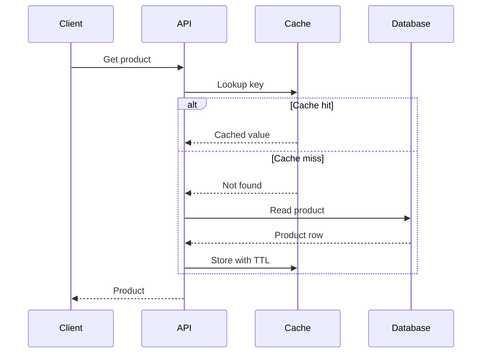

Use an architecture diagram to explain the components involved in a cache miss. Use a sequence diagram to explain the order in which those components act. A useful design discussion often needs both, because a connection between two services does not tell you when that connection is used.

Consider a product API that reads from a cache before querying its database. The team is deciding whether to add caching to an endpoint. One reviewer wants to understand the new dependency. Another wants to know what happens when the requested key is absent. Those are different questions about the same design.

## Start with the components

The [cache-aside architecture example](https://hudsonkit.com/arc/examples/cache-aside) gives the application, cache, and database distinct places in the drawing. Its connections identify three relationships: lookup or populate the cache, read the database on a miss, and return the database row to the application.


Adapted from Arc's [cache-aside example](https://hudsonkit.com/arc/examples/cache-aside). Repeated descriptions were removed for this illustration; the original relationships are preserved.

That view makes a useful responsibility visible: the application accesses both stores. The cache does not fetch the missing row itself in this example. Putting the cache between the application and database in a simple linear chain would suggest a different responsibility.

Keep the architecture drawing small enough to make that distinction obvious. A load balancer, deployment region, and monitoring service might exist in production, but they do not help answer who performs the database read. Add them when they matter to the question under review.

If the cache becomes unavailable, investigate the application: it is the component that reaches both stores. The drawing does not show that a fallback exists.

## Show the two request paths

A sequence diagram adds the missing order. This example begins with a client request, then separates a cache hit from a cache miss:



The cache-hit branch returns a cached value without a database read. The cache-miss branch reads the product row and stores it in the cache with a time to live before the API returns the product. The final response sits outside the alternative fragment because both branches reach it.

The sequence raises a question the component map does not: does the API wait for cache population before responding? The example places the store message before the response, but does not show a cache acknowledgement. If completion or failure of that write affects the response, add those messages explicitly. Message order alone does not define the implementation's waiting behavior.

The diagram also omits expiration policy, concurrent misses, and stale values. Treat each as its own design question.

## Make the sequence runnable in a React page

Arc has a native sequence player for supported Mermaid source. In an existing React application, install the viewer:

```bash
npm install @hudsonkit/arc-viewer@0.14.0
```

Pass the complete Mermaid string above to this component as its `source` prop:

```tsx
import { ArcMermaidPlayer } from '@hudsonkit/arc-viewer'

export function CacheRequest({ source }: { source: string }) {
  return (
    <ArcMermaidPlayer
      source={source}
      mode="light"
      title="Product lookup"
    />
  )
}
```

The player presents participants, ordered messages, and the alternative fragment. It lets a reader step through the authored exchange. It does not execute the cache conditions or select a branch using live application data.

Inspect the parser result before embedding a longer sequence:

```ts
import { parseMermaid } from '@hudsonkit/arc-viewer'

const result = parseMermaid(source)
console.log(result.diagnostics)
```

Review any diagnostics before publishing. Arc supports the `participant`, message, `alt`, and `else` syntax used here. Its [sequence guide](https://github.com/hudsonkit/arc/blob/main/docs/mermaid-sequences.md) lists the current syntax boundaries. A Mermaid diagram that uses additional constructs needs its own check.

## Choose the view by the review question

| Reader's question | Start with | Inspect next |
| --- | --- | --- |
| Which components are involved? | Architecture | Responsibilities and dependencies |
| What happens after a cache miss? | Sequence | Message order and returned values |
| Where does a failure policy belong? | Architecture | The component that owns the decision |
| What happens when that policy runs? | Sequence | Failure, retry, and response messages |

Keep the two views consistent by using the same names and responsibilities. If the sequence introduces a service absent from the architecture drawing, either add it or explain the difference in scope. Here, the architecture’s Application is the sequence’s API. Use one name when adapting the pair for your own system. The sequence also adds the client to show where the request starts and the response ends.

Arc keeps architecture data and native sequences as separate diagram families. Use `ArcDiagramData` for architecture views and `ArcMermaidPlayer` for sequence playback. The Mermaid import adapter can project a sequence into architecture data, but that projection loses sequence semantics and reports a warning. It is the wrong starting point when ordered interactions are the point of the story. [API distinction](https://github.com/hudsonkit/arc/blob/main/docs/mermaid-import.md)

Open the [cache architecture](https://hudsonkit.com/arc/examples/cache-aside) and [cache sequence](https://hudsonkit.com/arc/examples/cache-sequence) side by side. Change one real behavior, such as returning a response before populating the cache. Update the sequence first, then check whether the architecture's responsibilities still match. That exercise gives the next reviewer something specific to agree with or correct.
